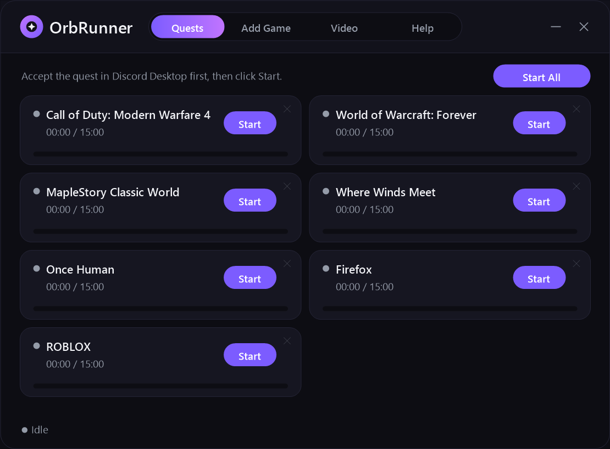

# 🔮 OrbRunner

> A lightweight, portable companion tool for Discord Quests & Orbs.

OrbRunner allows you to complete 15-minute Discord play quests without downloading 100 GB game files, and prevents 30-second video quests from pausing when you tab away.

---

### [📥 Download Latest Release (QuestRunner.exe)](https://github.com/almosthoney/OrbRunner/releases/latest)

---

## ✨ Features

- **🎮 15-Minute Play Quests:** Generates lightweight stand-in processes recognized by Discord's official game detector so quests tick up in the background.
- **🎬 Video Quest Unpauser:** One-click script for your browser to keep video quests progressing muted while you multitask or game.
- **🔍 10,000+ Game Catalog:** Searches Discord's public detectable games database, automatically floats newest quest additions to the top, and supports custom `.exe` paths.
- **📦 100% Portable:** Single file (~77 KB), zero external dependencies, no installation, and never touches `AppData` or the registry.

---

## 🚀 How to Use

### 1. Play Quests (Discord Desktop)
1. In Discord Desktop, click **Accept Quest** (under **Discover → Quests** or **Settings → Gift Inventory**).
2. In OrbRunner, click **Start** next to that game (or **Start All** to run multiple at once).
3. A mini status window will open so Discord detects the process — you can freely minimize (`—`) it to your taskbar.
4. Keep Discord open until the timer reaches **15:00 (100%)**, then click **Claim Reward** in Discord!

### 2. Video Quests (Web Browser)
1. Open `https://discord.com/discovery/quests` in Chrome, Edge, Brave, or Firefox.
2. Press `F12` (or `Ctrl+Shift+I`) to open Developer Tools, then click the **Console** tab.
3. If your browser shows a paste warning, type `allow pasting` and press `Enter`.
4. In OrbRunner's **Video** tab, click **Copy Script**, paste it into the Console (`Ctrl+V`), and press `Enter`.
5. Click **Watch Video** on any quest — it will play muted in the background while you multitask.

---

## 🔒 Safety & Privacy

- **No Tokens / Login Required:** OrbRunner never asks for or touches your Discord account token or passwords.
- **No Injections:** Does not inject into Discord's process or modify game files.
- **100% Local:** Stand-in processes run offline on your machine with zero background spyware or telemetry.

---

## 📜 License
MIT License. Free for personal use.
